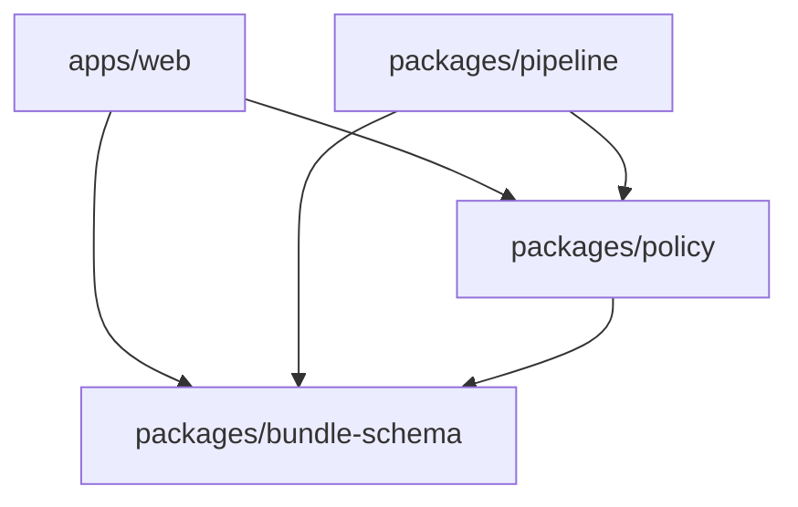
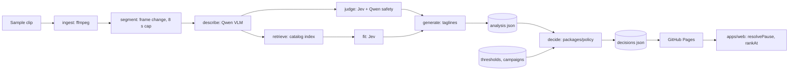
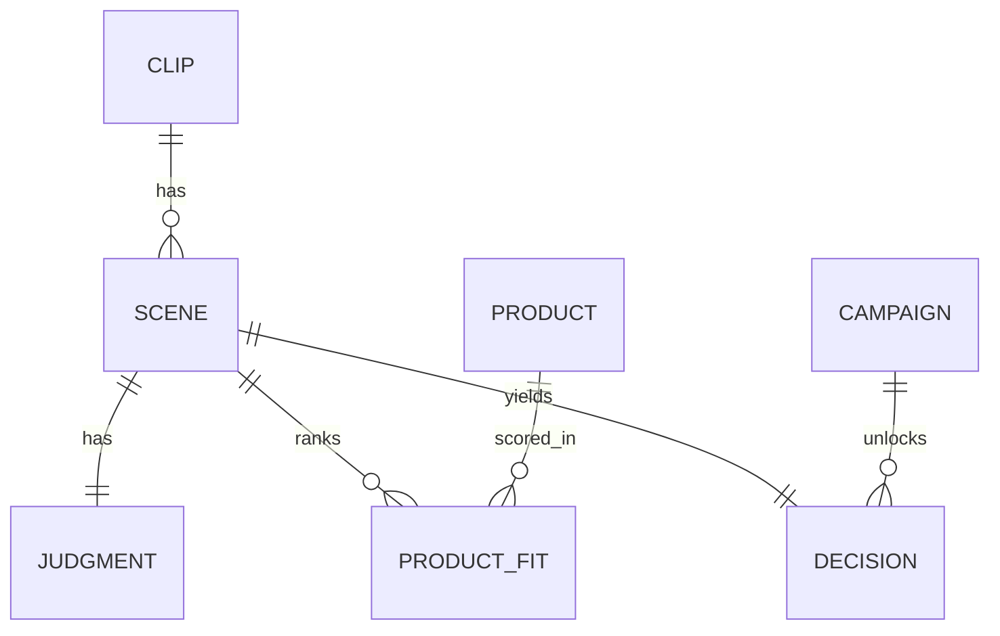

# Architecture Spine: Pausall

## Design Paradigm

Precomputed read model with a functional core. Models run only offline, on the author's machine. Everything the viewer touches is a committed, static artifact read by pure code.

| Layer | Location | Role |
|---|---|---|
| Contract | `packages/bundle-schema` | Types and validators for every artifact and config file. No logic. |
| Functional core | `packages/policy` | Pure rules: suppression, reason, scene lookup, price and split, ranking window, sentiment map, tagline check. No I/O. |
| Pipeline (offline) | `packages/pipeline` | Pipes-and-filters stages that call models and write `analysis`. Also runs `decide` and `eval`. |
| Read side (online) | `apps/web` | Static SPA. Loads a manifest and `decisions`, plays video, calls only the resolve and format functions of `policy`. |

## Invariants & Rules



Arrows are the only allowed imports, enforced by a lint rule on package imports (AD-23). `web` and `pipeline` never import each other. `policy` imports no model client, file system or browser API.

Rule ids are `R1` to `R6` and `R3b` (see AD-6) and are the only rule ids used in code, artifacts and evaluation output.

### AD-1: Precompute and serve [ADOPTED]

- **Binds:** F1, F2, F3, F4, FR-2, FR-12, NFR latency and cost
- **Prevents:** a model or API call on the playback or pause path; two analysis implementations that disagree
- **Rule:** After the manifest, `decisions`, video and static assets load, the web app makes no API or model request. Fonts are self-hosted and product images for the current list are preloaded so the pause view renders from memory. Sample clips are analyzed only by `packages/pipeline` run by the author.

### AD-2: Two artifacts, one direction of flow [ADOPTED]

- **Binds:** F1, F3, F4, F6, F10
- **Prevents:** a threshold or campaign change forcing a model re-run; the web reading raw model output; committed decisions drifting from their inputs
- **Rule:** `analysis/<clip>.json` holds model outputs only (descriptions, judgments, fit scores, reason inputs, taglines, token and cost metadata) and is committed. `decisions/<clip>.json` is derived by `packages/policy` from `analysis`, `config/thresholds.json` and `config/campaigns.json` with no model call. `decisions` is committed and byte-for-byte reproducible: no timestamps, sorted keys, integer money and time. It records `analysisHash`, `thresholdsHash` and `campaignsHash`. CI regenerates `decisions` and fails on any diff to the committed files. The web reads the manifest, `decisions` and product files only, never `analysis`. Per scene, `decisions` carries a `panel` object (`contextLabel` primary and optional secondary from the fixed scene-type list, `moodLabel`, `sentiment`, `safeTag` of safe, caution or unsafe) and never the free-text description or judge reasons.

### AD-3: One decision authority [ADOPTED]

- **Binds:** FR-10, FR-11, FR-13, FR-23, FR-24, policy rules
- **Prevents:** suppression logic duplicated in the pipeline, the evaluation and the browser; an evaluation that does not exercise the shipped path
- **Rule:** `packages/policy` is the only place that decides ad or no ad, picks the reason, prices an ad, splits revenue, applies the ranking window and checks a tagline. Thresholds and campaigns are inputs, never constants in code. `eval` calls the same `resolvePause` the app calls, for every time from 0 to the clip duration in 100 ms steps, plus every scene boundary at minus 1 ms, 0 ms and plus 1000 ms, and compares to human labels keyed by time range.

### AD-4: Fail closed

- **Binds:** FR-4, FR-11, NFR unknown means no ad
- **Prevents:** a half-valid artifact or an absent field read as a default that allows an ad
- **Rule:** Artifacts and config are validated by `bundle-schema` at load. Invalid or missing data, a null probability, a judge error, a pending scene or an unanalyzed time resolves to "analysis unavailable". `policy` treats an absent field as a failed rule, never as zero or true.

### AD-5: Describe, then judge [ADOPTED]

- **Binds:** FR-3, NFR prompt injection
- **Prevents:** dialogue or on-screen text steering a verdict
- **Rule:** The VLM writes one description per scene and must paraphrase, never quote, on-screen text or speech. Speech-to-text output (Qwen speech model, only when the manifest says the clip has dialogue) becomes a neutral dialogue summary inside that step. Judges receive the description only, never a transcript, frame text or OCR output.

### AD-6: Judges behind one interface [ADOPTED]

- **Binds:** FR-4a, FR-6, R3b, R5
- **Prevents:** pipeline code coupled to one vendor; the shipped path depending on the Jev-versus-LLM comparison; two meanings of "second signal"
- **Rule:** `SceneJudge` exposes `judgeScene(description)` and `judgeFit(description, candidates)`. Jev judges scene type, sentiment and product fit. Jev input is text only, Choice options are shuffled, and the still-image opt-in header is never used. Jev and the Qwen judge both answer the six sensitive-category questions. R5 is the safety second signal: the Jev and Qwen safety verdicts must both be safe. R3b is the relevance second signal: the Jev fit probability and the text-embedding cosine similarity must both clear their cutoffs, and its failure yields "Nothing fits well". The Qwen judge covers scene type, sentiment and fit when Jev errors, and never supplies a safety verdict in place of Jev. The Jev-versus-Qwen comparison is a separate offline `eval` run. The policy document was amended on 2026-11-23 to define R3b. [ASSUMPTION] The R3b pairing (fit probability plus embedding similarity) and its cutoffs are unconfirmed and tuned in the evaluation.

### AD-7: Taglines and reasons

- **Binds:** FR-6, FR-13, policy tagline rules
- **Prevents:** generating or showing text for a sensitive scene; a tagline that depends on thresholds changed later
- **Rule:** Product reason lines (FR-6) are templates filled from matched product attributes and the scene-type label, built with no model call, and never contain scene detail. A tagline is generated by the Qwen text model only for scenes where the safety rules (R1, R2, R5, R6) pass at thresholds relaxed by `taglineGateMargin` in config, and is stored with a `taglineCheck` result. `policy` owns `checkTagline(tagline, product)`. `decisions` carries a tagline only for outcome `ad`, and it is the product name when the check fails or no tagline exists.

### AD-8: Simulated values are typed

- **Binds:** FR-14, FR-15, FR-23 to FR-25, NFR labeling
- **Prevents:** a figure, ad or campaign rendered without the word Simulated
- **Rule:** Price, split, campaign, click, QR and the zero earned by a no-ad pause are produced by `policy` as values carrying `simulated: true`. UI components that render them take that type and always show the label. No simulated number is a bare `number` in web code.

### AD-9: One reason enum, no scene free text

- **Binds:** FR-11, EXPERIENCE voice rules
- **Prevents:** reason order or wording drifting; sensitive details leaking into rendered text; failed analysis shown as "sensitive scene"
- **Rule:** The four no-ad reasons are one enum in `policy`. R6 and schema validity are checked first: if either fails the reason is "analysis unavailable" regardless of other rules. Otherwise the precedence is sensitive scene (R1, R2, R5), nothing fits well (R3, R3b), no active campaign (R4). The UI maps the enum to policy wording. The only web-rendered text derived from scene content is the tagline of an `ad` outcome. The policy document carries the same order (amended 2026-11-23).

### AD-10: Stable content-derived IDs and integer time

- **Binds:** all artifacts
- **Prevents:** noisy diffs on re-run; mismatched joins; float-time disagreement
- **Rule:** Clip ID is the video file hash prefix. Scene ID is `s` plus `startMs` zero-padded to 7 digits. Product ID is the catalog product ID. All times in artifacts and IDs are integer milliseconds. Human labels join by time range, never by scene ID.

### AD-11: Hosting, operations and evaluation gate [ADOPTED]

- **Binds:** NFR cost, F7, guardrail
- **Prevents:** model keys in CI or the repo; video URLs in code; a server on the demo path; a guardrail that passes vacuously
- **Rule:** The app, artifacts and sample videos are served by GitHub Pages. The pipeline runs only on the author's machine with keys in a gitignored `.env`. CI type-checks, lints imports, runs `policy` tests, regenerates `decisions` (AD-2), runs the `eval` guardrail on the regenerated files and deploys. CI makes no model call. The video URL appears only in the manifest. Rollback is redeploying the previous commit. The eval fails CI when a labeled range has no coverage in `decisions`, when labeled unsafe seconds fall below a minimum in the eval config, or when any category has zero labeled scenes; "0 ads in 0 joined unsafe scenes" is a failure. `eval` writes to `docs/eval/`: agreement percent, guardrail, no-ad share, list stability (reorders per minute), cost per clip minute, per-category coverage, the Jev-versus-Qwen comparison and the 1 fps check. Labels live in `data/labels/<clip>.json`.

### AD-12: Catalog is an input, not a runtime dependency

- **Binds:** FR-17, NFR attribution
- **Prevents:** the full catalog or embeddings in the browser or repo; missing attribution
- **Rule:** The ABO slice and its embedding index are built locally and not committed. Only referenced products are copied (AD-19) with their small images. One attribution page shows the Amazon.com credit, the Collins et al. citation, the CC BY 4.0 licence link, a statement of changes and a no-endorsement line, reachable from the clip picker. The IAB taxonomy file is never committed; the scene-type list is the project's own fixed list.

### AD-13: Upload seam, no upload build

- **Binds:** F8, FR-18 to FR-21, FR-22
- **Prevents:** a rewrite when uploads arrive; upload code in the first release
- **Rule:** Pipeline stages are exported as a library with no file system assumptions so a later server can call them and return an `analysis` object. No upload code, server or feature flag is built in the first release (a recorded deviation from PRD F8). FR-22 is met by a `chunk` field on each scene (chunk 1 is the first 20 seconds); array order is by time (AD-16).

### AD-14: Decisions carry the outcome; the browser resolves, never decides

- **Binds:** F2, F3, F4, F10, AD-1, AD-2, AD-3
- **Prevents:** the browser re-evaluating rules with config and signals it does not have; a second source of truth
- **Rule:** `decisions/<clip>.json` stores per scene the outcome (`ad` or a reason), the top product, price and split, the ranked list, and `panel`. The web calls only `resolvePause(decisions, tMs)`, `rankAt(decisions, tMs, held)` and the formatters exported by `policy`. These read no thresholds, campaigns or analysis. The web never evaluates R1 to R6.

### AD-15: Judgment is a total record

- **Binds:** AD-2, AD-4, AD-6
- **Prevents:** a category that was not asked or errored being read as clear
- **Rule:** Each scene stores `judgments: { jev: J, qwen: J }` where `J` has `status` (`ok` or `error`), `verdict` (safe, caution, unsafe), `confidence` and `categories` with all six keys (violence, deathOrGrief, sexual, medicalTrauma, childFocused, intenseDialogue), each `{ flagged, p }`. A missing key, null or `status: error` fails validation and the scene resolves to "analysis unavailable". `policy` recomputes `flagged` from `p` and the category cutoff and never trusts the boolean alone. A category is flagged if either judge flags it. Confidence means the minimum of the two judges. Caution blocks the ad.

### AD-16: One ordered scene timeline, owned by policy

- **Binds:** F2, F3, F4, FR-22
- **Prevents:** wrong scene at a boundary; a pause outcome from a different scene than the displayed frame
- **Rule:** Scenes are sorted by `startMs`, use half-open intervals `[startMs, endMs)` and tile `[0, durationMs)` with no gap or overlap; `bundle-schema` rejects anything else. `policy` exports `sceneAt(decisions, tMs)`, and the web never searches scenes itself. A time outside every scene, or in a scene with `status: pending`, is "analysis unavailable". On pause the web passes the displayed-frame time (`requestVideoFrameCallback` media time when available, else `currentTime`). `resolvePause` evaluates the scene at that time and every scene that ends within 1000 ms before it, and returns an ad only if all of them resolve to an ad for the same product.

### AD-17: Ranking window shapes the list, never a suppression

- **Binds:** FR-7, FR-8
- **Prevents:** a held top product carrying an ad into a sensitive scene; a third hidden state
- **Rule:** The pause outcome is always from `resolvePause` and never reads a held product. `rankAt` returns the scene's precomputed stable top product, and the web may hold the previous top only while the scene ID is unchanged and for at most `holdMs` (5000, in config). A change of `outcome` between scenes, or any category flag turning on, releases the hold at once. FR-7 context (current plus previous 3 scenes) is applied in the fit stage by aggregating the previous 3 scenes' fit scores for ranking only. Safety judgments see the current scene description alone.

### AD-18: Top product and campaign

- **Binds:** F2, F4, F6
- **Prevents:** the list top and the ad showing different products; budget as hidden mutable state
- **Rule:** The top product is rank 1 of the full ranked list (relevance descending, ties by lower product ID). The pause ad is for that product only. A campaign is active when `active: true` in `campaigns.json`; `budget` is price metadata only and is never decremented. No campaign for the top product yields "No active campaign" even when a lower product has one.

### AD-19: Every entity has one owner artifact

- **Binds:** F2, F5, F7
- **Prevents:** two writers of one entity; a product page with no data
- **Rule:** `data/manifest/<clip-id>.json` (title, video URL, duration, "AI-generated" label, dialogue flag, attribution key) is hand-authored and validated. `data/products/<product-id>.json` (name, image path, description, key features, attribution) is written by `pipeline` from the local catalog and only for products referenced by `decisions`. `analysis` owns scenes, judgments, descriptions, fit scores and taglines. `decisions` owns outcomes, prices and splits and references products by ID only. CI fails on a referenced ID with no product file or a product file nothing references.

### AD-20: Threshold floors are schema invariants

- **Binds:** AD-3, AD-11
- **Prevents:** a lax config silently disabling a rule
- **Rule:** `bundle-schema` validates `config/thresholds.json` with hard bounds: safety confidence at least 0.8, relevance at least 60, both R3b cutoffs present, every category cutoff at most 0.5, `holdMs` at least 5000. Lowering a bound requires a schema edit and an ADR. A missing or out-of-range value fails the build.

### AD-21: Scene length cap and worst-case merge

- **Binds:** FR-1, F1
- **Prevents:** a sensitive moment hidden inside one long scene or between samples
- **Rule:** The segmenter splits any scene longer than 8 seconds at the cap and at dialogue change points. A scene's safety fields are the worst case over its sampled frames and dialogue windows. A sampled frame that cannot be described sets the scene `status: error`.

### AD-22: Pipeline operations

- **Binds:** NFR cost, F1
- **Prevents:** unrepeatable analysis; runaway cost; silent partial failure
- **Rule:** Every model is called by a pinned name recorded in `analysis` metadata (never an alias such as `jev-latest`). Each call has a timeout and a bounded retry; a stage failure is stored per scene as a typed error and never thrown past the artifact write. Each run has a cost cap in config and aborts when it is reached; token counts and cost per stage are recorded.

### AD-23: Testing and security floor

- **Binds:** all
- **Prevents:** unenforced rules; model text executed or stored; secret leaks
- **Rule:** Required tests: one per policy rule and reason order; schema rejection of gaps, overlaps, missing categories and out-of-range thresholds; `resolvePause` boundary cases; no network request after load and pause lookup under 500 ms in a browser test; one prompt-injection fixture. Model-derived text renders as text, never as HTML. A secret scan runs before commit and in CI. The web has no analytics; a simulated click lives only in the session.

## Consistency Conventions

| Concern | Convention |
|---|---|
| Naming | Packages and directories in kebab-case. Types in PascalCase. Artifacts named `<clip-id>.json`. |
| Numbers | Probabilities 0 to 1. Embedding similarity is cosine, -1 to 1. Relevance is an integer 0 to 100 rounded half up by `policy`, and the 60 cutoff compares the rounded integer. Money is integer cents; the 70/30 split gives the publisher share rounded down and the remainder to the platform. |
| Sentiment | `policy` holds one table from the 5 levels to -1, -0.5, 0, 0.5, 1 with mood labels. |
| Time | Integer milliseconds everywhere (AD-10). |
| Web state | Only: paused flag, playback time, session pause log (the tally and breakdown derive from it, one entry per pause event, a second pause in a scene counts again) and the display-only held top (AD-17). |
| Errors | Typed per-scene errors in `analysis` (AD-22). The web shows the reason, never a stack trace. |
| Config and secrets | `config/*.json` passed into `policy`. Secrets only in `.env`. |
| Accessibility and UI text | Follow EXPERIENCE (WCAG 2.2 AA floor, polite live region, reduced motion, 44 px targets, alt text) and DESIGN. |
| Docs | No em dashes, no contractions. |

## Stack

Values confirmed by a web check on 2026-11-22 and re-confirmed with `npm view` at scaffold on 2026-11-23.

| Name | Version |
|---|---|
| Node | 26 LTS, 26.13.1 (Jev SDK needs 22 or later) |
| pnpm | 12.23.0 |
| TypeScript | 7.0.2 |
| Vite with `@vitejs/plugin-react` | 8.3.8 with 6.3.0 |
| React | 19.3.1 |
| Tailwind CSS with `@tailwindcss/vite` | 4.3.5 |
| `@types/react` and `@types/react-dom` | 19.3.0 |
| `@types/node` | 26.6.6 |
| Vitest | 5.1.1 |
| oxlint (import lint) | 1.95.0 |
| secretlint with `@secretlint/secretlint-rule-preset-recommend` | 14.1.0 with 13.1.0 |
| ffmpeg (local) | 9.1 |
| Jev, TypeSafe `systemone` endpoint | `jev-1.14.0` pinned, SDK `@typesafe-ai/sdk` 0.7.0 |
| Qwen VLM, Model Studio (Singapore) | `qwen3-vl-flash` is retired (2026-10-10); candidates `qwen3.7-flash`, `qwen3.6-flash`, `qwen3.7-plus`; video input unconfirmed, test before pinning |
| Qwen text and embeddings | `text-embedding-v4` or `qwen3.7-text-embedding`; text model chosen at first run |
| Fonts, self-hosted | `@fontsource/lora` and `@fontsource/raleway` 5.3.0 |
| GitHub Pages, GitHub Actions | hosted; 1 GB site, 100 GB per month soft limit |

## Structural Seed





```text
pausall/
  packages/
    bundle-schema/   # types and validators for artifacts and config
    policy/          # pure rules, resolvePause, rankAt, sceneAt
    pipeline/        # stages, SceneJudge, CLI: analyze, decide, eval
  apps/web/          # Vite React SPA
  config/            # thresholds.json, campaigns.json, eval config
  data/manifest/     # hand-authored clip manifests
  data/analysis/     # committed model outputs
  data/decisions/    # committed, reproducible, served by the web
  data/products/     # referenced products only
  data/labels/       # human labels keyed by time range
  docs/adr/          # decision records
  docs/eval/         # evaluation results and failures
```

## Capability to Architecture Map

| Capability | Lives in | Governed by |
|---|---|---|
| F1 Scene analysis, F9 chunking | `packages/pipeline` | AD-5, AD-6, AD-13, AD-15, AD-21, AD-22 |
| F2 Product list, F3 Scene panel | `apps/web` reading `decisions` | AD-2, AD-14, AD-16, AD-17, AD-18 |
| F4 Pause view | `apps/web` calling `resolvePause` | AD-3, AD-4, AD-9, AD-14, AD-16 |
| F5 Product page and QR | `apps/web`, `data/products` | AD-8, AD-19 |
| F6 Campaigns | `config/campaigns.json`, `policy` | AD-18, AD-2 |
| F7 Catalog | `packages/pipeline`, attribution page | AD-12, AD-19 |
| F8 Uploads | not built; seam only | AD-13 |
| F10 Simulated revenue | `policy`, session pause log in `apps/web` | AD-3, AD-8 |
| Evaluation and guardrail | `packages/pipeline` `eval`, CI | AD-3, AD-11, AD-20 |

## Deferred

- PRD and EXPERIENCE edits: FR-22 and the "analyzing" states apply to uploads only for samples; F8 has no feature flag in the first release.
- Qwen model choice, video input support, prices and data terms; Jev numeric rate limits: one test call and a console check before the first pipeline run.
- Whether 1 frame per second is enough and adaptive sampling: the evaluation decides.
- The 4 sample clips, their dialogue flags and the labeled evaluation set: Phase 5 and 6.
- Upload server host, notice flow, and browser-side frame sampling (FR-18) against the ffmpeg ingest: only if uploads are turned on.
- A product exclusion list for products that are themselves sensitive in a safe scene: after the first evaluation.
- ABO licence file: open it and note the older CC BY-NC wording some Amazon pages still show.
- Trademark, EU and UK privacy, and AI clip tool terms: PRD open items, outside the architecture.
- UI component details, the in-between breakpoint and typography sizes: build, against DESIGN.
- Phase 2 untriaged reconcile gaps (18).
